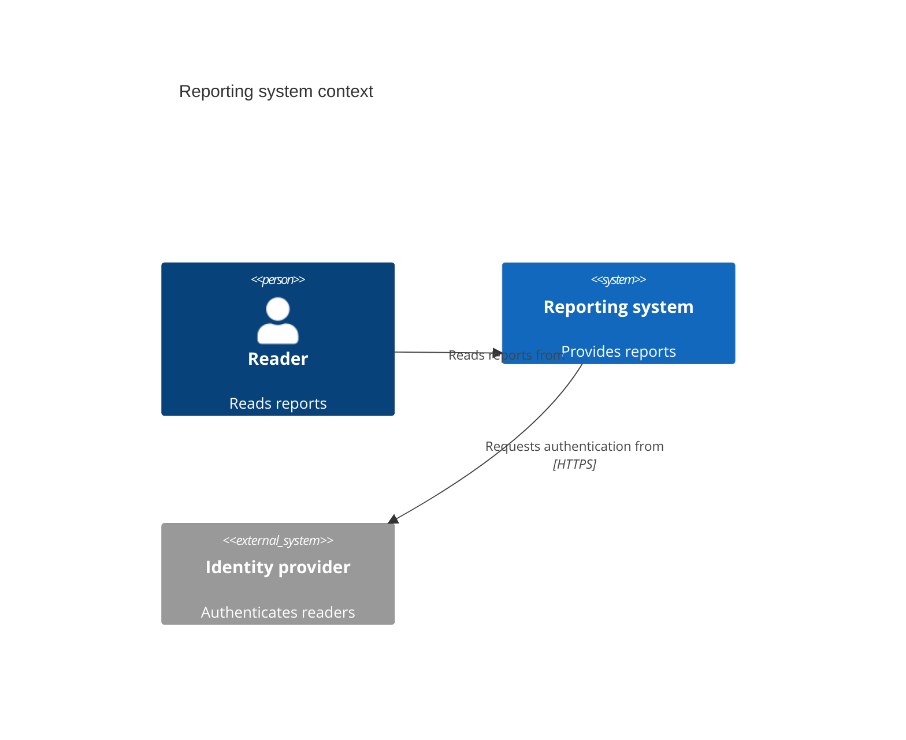
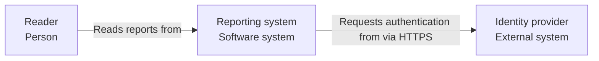

# C4 views for architecture docs

Use a view only when it answers a reader's concrete question. The [C4 model](https://c4model.com/diagrams) has four zoom levels; System Context and Container are sufficient for many projects. The diagram type does not dictate a Markdown file layout.

| View | Question it answers |
| --- | --- |
| System Context | Who uses the system, and which external systems does it interact with? |
| Container | Which applications and data stores make up the system, and how do they interact? |
| Component | What are the main responsibilities and interactions inside one container? |
| Code | Which code elements implement a complex component? Use only when code structure needs explanation. |
| System Landscape | How do multiple systems in the chosen scope relate without focusing on one? |
| Dynamic | How do selected elements interact for one scenario, in order? |
| Deployment | Where do container instances run in one environment? |

Do not treat Deployment as level four. A C4 Container is an application or data store, not a Docker container, state-management library, or folder. A Component is a logical unit within one Container; Code elements are classes, functions, or similar implementation units. Keep dynamic behavior and deployment details out of static structure diagrams unless they clarify a relationship.

## Diagram quality

- Select the smallest view that answers the reader's question. Give each element a clear name, responsibility, and verified technology where relevant. Show the boundary and label directional relationships with evidenced actions, such as `Publishes events to`; use a broader action when the evidence does not establish the protocol or data.
- Reduce a crowded diagram by narrowing scope or splitting views; no fixed element limit applies. Use ordinary Markdown links between documents; Mermaid C4 does not support clickable element links.
- Review every element, boundary, arrow, and label against code, configuration, deployment evidence, or clearly identified user requirements. Complete when every current-state relationship is supported, the selected view answers its question, and the target reader renders it or its rendering limitation is reported.

## Mermaid choice

Mermaid's [native C4 syntax](https://mermaid.js.org/syntax/c4.html) is experimental. It supports `C4Context`, `C4Container`, `C4Component`, `C4Dynamic`, and `C4Deployment`; it has no native Code or System Landscape type. Determine the target Markdown reader and render a small diagram there before relying on native C4. If it fails, use a supported Mermaid `flowchart` that preserves the same C4 elements, boundary, and relationships, and render it again. For a Code view, use `classDiagram` for meaningful class/interface relationships or `flowchart` for modules, calls, or data flow. If the reader cannot be accessed, mark rendering unverified.

These examples illustrate syntax only; replace every element and relationship with facts verified in the target project.

Equivalent fallback when the target reader cannot render `C4Context`:

